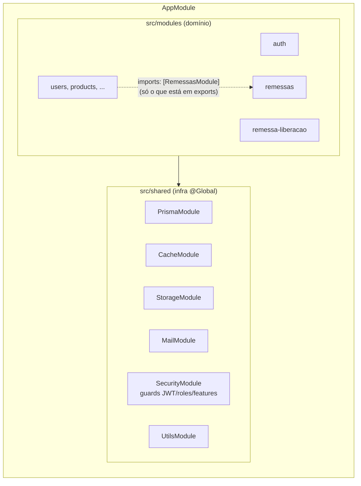
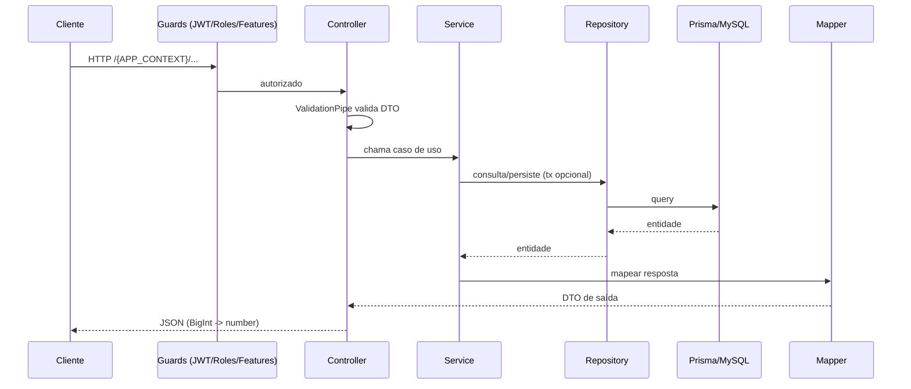

# Arquitetura modular — letscom-api

NestJS 10 + Prisma (MySQL) + Redis. Migração do backend Laravel 11.
Este documento é a referência que o tech lead (humano ou IA) usa para aprovar ou bloquear código.

## Visão geral



- `src/shared` é infraestrutura transversal. **Nunca importa nada de `src/modules`.**
- `src/modules/<modulo>` é um contexto de negócio isolado. Para usar um **provider** (service)
  de outro módulo: o módulo dono coloca em `exports` e o consumidor faz `imports: [OutroModule]`.
  Nunca registrar em `providers` um repository/service que pertence a outro módulo.
- Funções puras (mappers/helpers exportados como função, ex.: `serializeUser`) podem ser
  importadas entre módulos. Se forem usadas por 3+ módulos, mover para `src/shared/utils`.
- Dívida conhecida: `enderecos-entrega` registra `EnderecoRepository` de `enderecos` direto.
  Ao mexer nesse módulo, trocar por `EnderecosModule` exportando um service.
- `src/config` centraliza env (`configuration.ts` + validação em `env.validation.ts`).

## Anatomia de um módulo

```
src/modules/<modulo>/
├── <modulo>.module.ts        # registra controllers/providers; exports = API pública do módulo
├── controllers/              # HTTP: rota, guard, DTO, Swagger. Delega ao service.
├── dto/                      # entrada validada (class-validator / class-transformer)
├── services/                 # regra de negócio e orquestração (transações)
│   └── helpers/              # funções puras e use-cases auxiliares usados pelos services
├── repositories/             # único lugar com acesso ao Prisma
├── mappers/                  # entidade Prisma -> resposta HTTP (formato do Laravel)
├── exceptions/               # exceções específicas do módulo (estendem BusinessException)
└── tests/                    # testes unitários *.spec.ts

test/e2e/<modulo>/            # testes e2e *.e2e-spec.ts (HTTP real + banco de teste)
```

Pastas são criadas sob demanda — um módulo sem regra não precisa de `services/helpers/`.

## Um service por funcionalidade (responsabilidade única)

**Proibido "service deus"** — uma classe que concentra todas as operações do módulo.
Referência: módulo `auth`. Cada funcionalidade tem seu próprio arquivo e sua própria classe:

```
src/modules/auth/services/
├── auth-client-user.service.ts        # login do cliente          → execute(dto)
├── auth-subordinate-user.service.ts   # login do subordinado      → execute(dto)
├── auth-reset-password.service.ts     # redefinir senha           → execute(body)
├── request-password-reset.service.ts  # solicitar redefinição     → execute(body)
├── jwt-token.service.ts               # serviço técnico: assinar JWT
└── helpers/                           # funções puras compartilhadas entre os services
```

Regras:

- **1 arquivo = 1 funcionalidade = 1 classe**, nomeada pela ação:
  `<acao>-<recurso>.service.ts` → `class <Acao><Recurso>Service`
  (ex.: `solicitar-remessa.service.ts` → `SolicitarRemessaService`).
- **Um único método público: `execute(...)`.** É o contrato fixo do padrão (como no auth), por isso
  fica em inglês mesmo com a regra de nomes em português. Métodos auxiliares são `private`.
- **Controller injeta um service por endpoint** e só chama `execute`.
- Lógica compartilhada entre funcionalidades do mesmo módulo:
  - pura → função em `services/helpers/`;
  - com I/O → repository (se for acesso a dados) ou um **service técnico** pequeno e focado
    (ex.: `JwtTokenService`, `RemessasCacheService`). Service técnico não é caso de uso e não
    é chamado pelo controller.
- Service não chama outro service de funcionalidade (caso de uso não chama caso de uso). Se dois
  casos de uso compartilham passos, extraia o passo para helper/repository/service técnico.
- **Sinal de que precisa dividir:** mais de um método público, mais de ~150 linhas, ou nome
  genérico (`remessa.service.ts`, `*-manager`, `*-handler`).
- Um spec por service: `tests/<acao>-<recurso>.service.spec.ts`.

Dívida conhecida (dividir aos poucos, quando o arquivo for tocado):
`remessas/services/remessa.service.ts` (543 linhas), `modelos-tecnicos/services/modelo-tecnico.service.ts`,
`credit-sales/services/credit-sale.service.ts`, `auth/services/refresh-token.service.ts`
(5 métodos públicos: logout, refresh, issue, revokeAll, rotate).

## Fluxo de uma requisição



## Regras de dependência (bloqueantes)

| Camada | Pode depender de | Não pode |
|---|---|---|
| Controller | services do próprio módulo, DTOs, decorators/guards de `shared` | repository, `PrismaService`, outro módulo direto |
| Service | repositories e helpers do próprio módulo, services **exportados** de outros módulos, `shared` | `PrismaService` direto (exceto `$transaction`), repository de outro módulo |
| Repository | `PrismaService`, tipos `@prisma/client` | services, regra de negócio, `HttpException` |
| Mapper / helper | nada com efeito colateral (funções puras) | I/O, banco, HTTP |
| `shared` | bibliotecas externas, `config` | qualquer coisa de `src/modules` |

Padrões obrigatórios:

- **Transação**: o service abre `this.prisma.$transaction(async (tx) => ...)` e repassa `tx`
  aos repositories. Todo método de escrita de repository aceita `tx?: Prisma.TransactionClient`
  e usa `(tx ?? this.prisma)`.
- **Erros**: regra de negócio lança `BusinessException` (ou subclasse em `exceptions/`).
  Repository nunca lança `HttpException`. `AllExceptionsFilter` formata a resposta.
- **Autorização**: via decorators `@Roles`, `@Features`, `@Public` + guards de `shared/guards`.
  Nunca checar papel manualmente no controller.
- **Resposta**: sempre por mapper, preservando o contrato do Laravel (o front depende dele).
- **Config**: ler env só via `ConfigService` com chaves de `configuration.ts`; variável nova
  exige entrada em `env.validation.ts` e em `test/jest.setup.ts`.
- **Cache**: invalidação via `VersionedCacheService`; não usar Redis direto.

## Testes — integridade obrigatória

Toda mudança de comportamento vem com testes. PR sem teste é bloqueado.

### Unitários (`npm test`)

- Local: `src/modules/<modulo>/tests/<arquivo>.spec.ts`.
- Obrigatório para todo service, helper e mapper **novo ou alterado**.
- Isolamento total: `Test.createTestingModule` com dependências em `useValue` (mocks `jest.fn()`).
  Nada de banco, Redis, rede ou disco.
- Cobrir no mínimo: caminho feliz, cada `BusinessException` possível, bordas (lista vazia,
  `null`, valores limite) e que a transação/repository foi chamado com os argumentos certos.
- Nome do `describe` = classe/função; nome do `it` em português descrevendo o comportamento
  (`it('lança erro quando o saldo de créditos é insuficiente')`).

### E2E (`npm run test:e2e`)

- Local: `test/e2e/<modulo>/<recurso>.e2e-spec.ts`. Bootstrap com
  `test/e2e/helpers/criar-app-e2e.ts` (mesmo prefixo, pipes e filtros do `main.ts`).
- Obrigatório para todo endpoint **novo ou com contrato alterado**.
- Roda no host contra o `docker-compose.test.yml` (`letscom-bd-test` + `letscom-redis-test`), com as variáveis do `.env.test`.
  Como executar: [docs/testes.md](testes.md).
- Para começar do zero dentro de uma suíte: `limparBanco(prisma)` de `test/e2e/helpers/limpar-banco.ts`.
- Cobrir no mínimo por endpoint:
  1. `401` sem token (quando não é `@Public`);
  2. `403` com papel/feature insuficiente (quando aplicável);
  3. `400` com DTO inválido;
  4. `2xx` no caminho feliz validando o **formato** da resposta;
  5. efeito persistido no banco (consultar via `PrismaService` após a chamada).
- Cada teste cria e limpa seus próprios dados; nunca depender de ordem ou de dados de outro teste.

## Banco e migrations — regra para IA

**Nenhuma IA (Claude, Cursor ou outra) executa migration ou altera o banco.**

A IA pode:
- editar `prisma/schema.prisma`;
- escrever o arquivo `prisma/migrations/<AAAAMMDDHHMMSS>_<nome>/migration.sql`;
- rodar `npx prisma generate` (só gera tipos, não toca no banco).

A IA **não pode** rodar: `prisma migrate *`, `prisma db *` (push, execute, seed, pull),
`npm run prisma:migrate`, `npm run prisma:seed`, nem reiniciar/subir containers
(`docker restart`, `docker compose up`, `npm run docker:*`), porque o container executa
`prisma migrate deploy` ao iniciar.

Ao terminar uma mudança de schema, a IA **devolve ao dev** o SQL gerado e os comandos para ele
executar no próprio terminal, neste formato:

```bash
# 1. revisar o SQL
cat prisma/migrations/<pasta>/migration.sql

# 2. aplicar (escolha um)
npm run docker:restart          # container aplica migrate deploy ao subir
npx prisma migrate deploy       # aplicando direto do host

# 2.1 atualizar o client dentro do container (node_modules próprio) para o hot reload compilar
docker exec letscom-api-dev npx prisma generate

# 3. validar com os testes e2e (sobe o ambiente de teste se preciso, migra o letscom_test e testa)
npm run docker:test
npm run test:e2e
```

O bloqueio está reforçado em `.claude/settings.json` (`permissions.deny`), que também barra
`docker exec` — qualquer comando dentro do container é devolvido ao dev.

### E2E e banco de teste

O ambiente de teste é o `docker-compose.test.yml` (`npm run docker:test`): MySQL `letscom-bd-test`
(porta `3308`, banco `letscom_test`) e Redis `letscom-redis-test` (porta `6380`). Compose separado do dev,
mas com o mesmo nome de projeto, então aparece no grupo `letscom-dev`. Os containers ficam no ar; o
`npm run test:e2e` aplica as migrations (`pretest:e2e`) e limpa os dados antes e depois da suíte.

`npm run test:e2e` aplica migrations e `npm run docker:test` sobe containers, então quem executa é o **dev**.
Passo a passo completo: **[docs/testes.md](testes.md)**.
